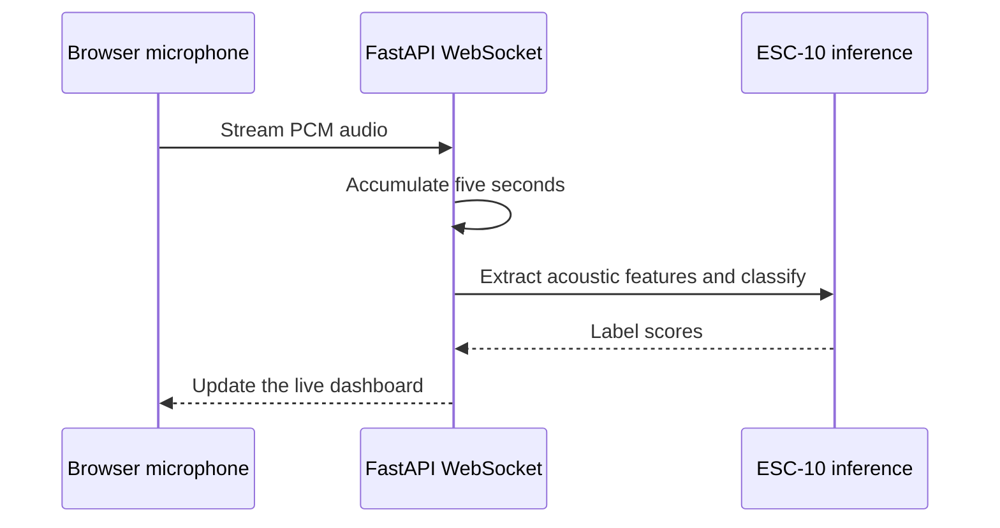
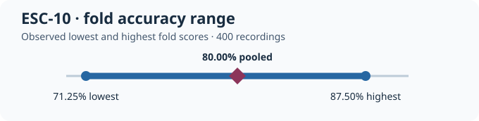
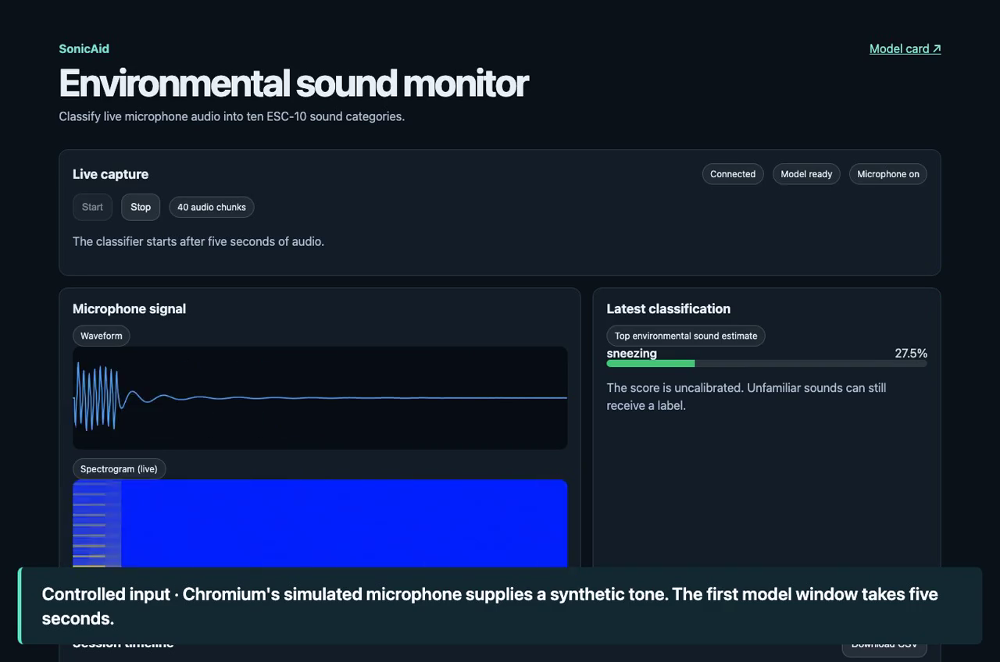

# SonicAid · Environmental sound classification

Portfolio by [Khush Bhavin Maru](https://github.com/Khushx11) · Adelaide University MAAIM.

SonicAid classifies five-second environmental sound windows from a WebSocket audio stream. The FastAPI backend serves a checkpoint trained on ESC-10, and the React frontend displays predictions for local exploration. The repository also preserves an earlier synthetic-data scaffold for sensory-therapy research.

> **Scope:** environmental sound classification research, not a diagnostic, clinical or therapy-evaluation system. ESC-10 contains no patient outcomes, engagement scores or emotion labels. A separate older multi-task training scaffold uses synthetic data and must not be confused with the ESC-10 results.


## Original publication

**Sonic Aid** · *IOSR Journal of Engineering*, vol. 15, issue 6, series 1, pp. 1–5, June 2025. [Read the paper](https://iosrjen.org/Papers/vol15_issue6/A15060105.pdf)

Khush Maru (first author), Nevil Parekh, Hardik Patel, Vaishali Wadhe, and Moinuddin Sheikh.

I co-authored this paper during my **Bachelor of Technology in Artificial Intelligence and Data Science** at **K J Somaiya Institute of Technology** in Mumbai. The institute is permanently affiliated with the **University of Mumbai**, which awards the degree. [Official programme syllabus](https://department.kjsieit.in/aids/documents/syllabus/AC%20Approved_Autonomy_%20Syllabus%20Scheme_II%20B_AY_23-24_Sem-III%20and%20IV%20of%20AI-DS.pdf) · [Institute affiliation](https://kjsit.somaiya.edu.in/en/introduction)

The 2025 study used LibriSpeech and GTZAN as speech and music sources. It describes sub-band coding and acoustic features including MFCCs, spectral centroid and zero-crossing rate, with SVM and Gaussian mixture classifiers. The paper reports **94% overall accuracy** on its binary classification task.

| Class | Reported precision | Reported recall |
| --- | ---: | ---: |
| Speech | 92% | 93% |
| Music | 95% | 94% |

These are paper-reported classification results. The current repository's ESC-10 checkpoint has its own dataset, labels and evaluation protocol. The original paper discusses sensory accessibility as an application and identifies overlapping speech and music as a limitation.

## How SonicAid evolved after publication

- **A broader classification task.** The paper studied two labels, speech and music. The current app serves a ten-class environmental sound checkpoint trained on ESC-10. Official five-fold testing on 400 recordings yielded **80.00% pooled accuracy** and **0.8016 macro-F1**. These results describe a different task and test population. [Model card](docs/esc10_model_card.md)
- **A live browser-to-model workflow.** A React dashboard streams microphone audio to FastAPI over WebSocket, where the model classifies five-second windows. The browser integration test checks prediction delivery, microphone cleanup and permission-denied feedback. [Live demo](#quick-demo) · [Tests](#testing)
- **Repeatable model builds and broader evaluation.** The published checkpoint has a SHA-256 digest and an automated download-and-inference check. The repository also includes separate evaluation pipelines for ESC-50 and UrbanSound8K with source-overlap checks. The dashboard continues to use ESC-10. [Checkpoint release](https://github.com/Khushx11/SonicAid/releases/tag/esc10-baseline) · [Expanded benchmarks](#expanded-environmental-audio-benchmarks)

### Which audio task does each result describe?

| Where to look | Audio task | How to interpret the result |
| --- | --- | --- |
| [2025 publication](#original-publication) | Speech versus music using LibriSpeech and GTZAN | Paper-reported binary classification results |
| [Live dashboard](#quick-demo) and [ESC-10 model card](docs/esc10_model_card.md) | Ten environmental sound classes | Held-out fold scores for the model family used by the dashboard |
| [Expanded benchmarks](#expanded-environmental-audio-benchmarks) | ESC-50 and UrbanSound8K | Separate offline experiments with their own classes and splits |

## Listen to the live stream





Each point is a separate test fold. The dashed line is pooled accuracy across all 400 out-of-fold predictions. The released checkpoint was then fitted on all 400 recordings. [Fold results and protocol](docs/esc10_model_card.md#evaluation-protocol)

## Quick demo

[**Watch the 80-second captioned demo**](https://raw.githubusercontent.com/Khushx11/SonicAid/main/docs/demo/walkthrough.mp4)

The local dashboard uses the published ESC-10 checkpoint with a synthetic microphone source. The clip shows how an unfamiliar sound can still receive a known label.

[](https://raw.githubusercontent.com/Khushx11/SonicAid/main/docs/demo/walkthrough.mp4)

## My contribution

SonicAid is my audio-intelligence portfolio project. It grew from a research prototype into an environmental sound monitor. The current implementation combines the ESC-10 benchmark and published checkpoint with a FastAPI WebSocket stream and React interface. The repository documents the five-fold evaluation and tests the browser-to-checkpoint path, microphone release and sample-rate conversion.

## Components

| Component | Location | Purpose |
| --- | --- | --- |
| Streaming API | `backend/app/api/routes/stream.py` | Receives 16 kHz PCM16 via WebSocket; predicts five-second environmental sound windows with an installed checkpoint |
| Model and inference | `ml/models/`, `backend/app/ml_inference/` | PyTorch architecture and feature extraction |
| Real-world training and evaluation | `ml/real_audio/esc10.py` | ESC-10 acoustic features, official five-fold evaluation and a serialized SVC baseline |
| Earlier research scaffold | `ml/training/`, `ml/configs/` | Synthetic multi-task experimentation, not clinical validation |
| Session endpoints | `backend/app/api/routes/sessions.py` | Lists sessions and exports session data as CSV |
| Frontend | `frontend/` | React interface for local exploration |
| Research proposal | `plan/` | Design and methodology notes |

## Local development

### Backend

Run these commands from the repository root:

```bash
python -m venv .venv
source .venv/bin/activate
pip install -r requirements.txt
uvicorn backend.app.main:app --reload --port 8000
```

Health endpoint: `http://localhost:8000/api/health`.

HTTP requests and browser WebSockets permit only the default local development origins (`http://localhost:5173` and `http://127.0.0.1:5173`). To authorise a different frontend, set an explicit comma-separated allowlist such as `SONICAID_ALLOWED_ORIGINS=https://your-trusted-domain.example`. The server does not support wildcard origins.

### Frontend

Use Node.js 22.12 or newer within the Node.js 22 release line. In a second terminal:

```bash
cd frontend
npm ci
VITE_API_BASE=http://localhost:8000 npm run dev
```

Open `http://localhost:5173`.

### Verified real-audio result

The first **successful official five-fold ESC-10 run** achieved **80.00% pooled out-of-fold accuracy** and **0.8016 pooled macro-F1** across 400 real recordings. Individual fold accuracies ranged from 71.25% to 87.50%. These are independently held-out fold measurements, **not clinical validation**.

The trained model, observed fold report, and SHA-256 digest are attached to the [ESC-10 model release](https://github.com/Khushx11/SonicAid/releases/tag/esc10-baseline). See the [model card](docs/esc10_model_card.md) and the [successful training run](https://github.com/Khushx11/SonicAid/actions/runs/45381962916) for evaluation protocol, exact results and limitations.

```bash
# Install and verify the released 370 KB model artifact.
python -m scripts.install_esc10_model

# Start the checkpoint-backed WebSocket inference service.
SONICAID_ESC10_MODEL=ml/artifacts/esc10.joblib \
  uvicorn backend.app.main:app --reload --port 8000
```

When the checkpoint is absent the app explicitly reports `model_unavailable`; it never substitutes fabricated environmental sound predictions.

### Real labelled environmental audio (ESC-10)

**Dataset:** Karol J. Piczak, *ESC: Dataset for Environmental Sound Classification* (2015), [official repository](https://github.com/karolpiczak/ESC-50). ESC-50 contains 2,000 five-second environmental audio clips; this implementation uses only the 400 clips in the **ESC-10 subset**, separately identified by the publisher as CC BY licensed. Keep the source WAV recordings in the locally ignored `data/` directory and follow the publisher's attribution requirements. No third-party recordings are committed here.

From the repository root, with Python dependencies installed:

```bash
git init data/ESC-50
git -C data/ESC-50 fetch --depth 1 https://github.com/karolpiczak/ESC-50.git 33c8ce9eb2cf0b1c2f8bcf322eb349b6be34dbb6
git -C data/ESC-50 checkout --detach FETCH_HEAD
python -m ml.real_audio.esc10 train --dataset data/ESC-50 \
  --model ml/artifacts/esc10.joblib --metrics ml/artifacts/esc10_metrics.json

# Run the trained model on a separate WAV file.
python -m ml.real_audio.esc10 predict \
  --model ml/artifacts/esc10.joblib --audio /path/to/sample.wav

# Start actual streaming inference using the locally trained checkpoint.
SONICAID_ESC10_MODEL=ml/artifacts/esc10.joblib \
  uvicorn backend.app.main:app --reload --port 8000
```

The training code uses a fixed StandardScaler + RBF SVC baseline with 64-band log-mel mean/std, RMS and zero-crossing features. Each of the dataset's five predefined folds is held out once. The program writes observed fold accuracy, macro-F1 and a confusion matrix to `esc10_metrics.json`, then fits the final checkpoint on all 400 examples. It does not tune the estimator on held-out fold scores. The original run published the baseline checkpoint, SHA-256 and measured metrics as a release. Subsequent training runs attach their outputs to the individual workflow run. The [checkpoint smoke test](https://github.com/Khushx11/SonicAid/actions/runs/45384429350) loads the final all-data checkpoint and predicts on one source recording from its training set. The five held-out folds are the evidence for classification accuracy. Running the training script locally repeats the protocol, with results subject to environment differences.

**Model limitations:** SVC scores have not been externally calibrated; audio outside the ten trained categories is still classified into one of those classes. Training on fixed five-second clips does not guarantee robustness in a noisy room, on a different microphone or with overlapping sounds. No clinical, engagement or emotion claims follow from this dataset. Never load untrusted `.joblib` files, since joblib deserialization can execute arbitrary code.

### Synthetic-data model training

From the repository root with the Python environment activated:

```bash
python -m ml.training.train --config ml/configs/sonicaid_multitask_small.yaml
python -m ml.training.eval --config ml/configs/sonicaid_multitask_small.yaml --checkpoint ml/artifacts/sonicaid_best.pt
```

Checkpoints, local sessions, and generated data are ignored by Git. Depending on your machine, PyTorch audio dependencies may require platform-specific installation.

## Run locally with Docker Compose

With Docker Compose v2 running, use `docker compose up --build --wait` and open `http://localhost:5173`. On the first start the backend installs and verifies the published ESC-10 checkpoint into a named volume. The dashboard starts after `http://localhost:8000/api/ready` reports model readiness. Both published ports bind to loopback.

WebSocket sessions close after 30 seconds without audio or one hour total. The backend holds up to 16 active sessions and the latest 16 nonempty completed sessions in memory, with up to 7,200 prediction events per session. Restarting clears that history. CSV downloads are generated in memory and saved by the browser. The normal streaming path writes neither raw audio nor session reports to disk. This is a single-user local setup. A shared installation requires authenticated, per-user session access.

## Expanded environmental-audio benchmarks

| Dataset | Clips | Pooled accuracy | Pooled macro-F1 |
| --- | ---: | ---: | ---: |
| ESC-50 | 2,000 | 43.85% | 0.4339 |
| UrbanSound8K | 8,732 | 59.06% | 0.6090 |

These values come from the held-out evaluation logs. The downloadable metrics artifacts record per-fold exclusions, variability and confusion matrices. The datasets use distinct labels and recordings, so the two scores do not rank the datasets or predict performance in a new room. [Evaluation run and artifacts](https://github.com/Khushx11/SonicAid/actions/runs/45578746935)


- **ESC-50** contains 2,000 five-second clips across 50 classes and five official folds. It includes the 400 ESC-10 clips, so it is a broader benchmark with overlapping recordings. The full dataset is CC BY-NC. [Dataset, attribution and known preprocessing caveats](https://github.com/karolpiczak/ESC-50)
- **UrbanSound8K** contains 8,732 urban sound excerpts across ten classes and ten official folds. Extract the publisher's archive so the root contains `metadata/UrbanSound8K.csv` and `audio/fold1` through `audio/fold10`. Use it for non-commercial research under the publisher's conditions. [Dataset and download](https://urbansounddataset.weebly.com/urbansound8k.html) · [Archive](https://zenodo.org/records/1203745)

Run the experiments independently. For ESC-50, use the pinned checkout above.

```bash
python -m ml.real_audio.benchmarks esc50 --root data/ESC-50 --metrics ml/artifacts/esc50.json
python -m ml.real_audio.benchmarks urbansound8k --root data/UrbanSound8K --metrics ml/artifacts/urbansound8k.json
```

The evaluator keeps the official held-out folds and excludes any training clips whose source recording appears in that fold before fitting the scaler and RBF SVC. The report counts exclusions by fold. Where exclusions occur, results use a stricter training split than an unfiltered official-fold benchmark. It uses the existing mono 16 kHz features and zero-pads clips shorter than five seconds. Reports include the metadata digest, per-fold scores, mean and standard deviation of fold accuracy, pooled scores and a confusion matrix. The [benchmark workflow](.github/workflows/audio-benchmarks.yml) uploads the JSON reports. ESC-50 runs automatically when benchmark code changes. Start the workflow manually to include UrbanSound8K, whose official archive is 6 GB. Source audio stays out of Git. The WebSocket continues to serve the published ESC-10 checkpoint. These are separate research benchmarks with different class lists and evaluation populations.

## Streaming interface

The WebSocket endpoint `ws://localhost:8000/ws/stream` accepts binary 16 kHz mono PCM audio chunks. With `SONICAID_ESC10_MODEL` configured to a valid locally trained checkpoint, the service uses actual ESC-10 sound-class predictions from five-second rolling PCM16 windows. Without weights it sends a `model_unavailable` status and does not produce predictions. The frontend displays that status. Emotion and engagement fields are null, rather than invented. See `backend/app/api/routes/stream.py` for the current contract.

## Testing

```bash
pytest backend/tests
```

The GitHub Actions workflow builds the React app, runs backend regression tests and verifies that the installer can download the published checkpoint and serve a prediction over WebSocket. The WebSocket smoke test feeds a synthetic tone to the model. A separate Chromium check captures simulated microphone audio in the dashboard, verifies that the published checkpoint returns a result, and checks microphone cleanup and permission-denied feedback. These tests cover the browser-to-model integration. Physical microphone behaviour depends on the browser, permissions and device.

## Limitations and next steps

The [real-room evaluation protocol](docs/room-evaluation.md) specifies separate tests for room noise, overlapping sounds, unfamiliar classes, latency and abstention. It is an experiment plan awaiting permission-cleared recordings.

- The separate synthetic multi-task research scaffold is not clinically validated. The new ESC-10 pipeline uses real audio with environmental sound labels but lacks therapy-specific annotations.
- The current backend configuration is intended for local development. Browser origins are restricted, but **there is no user authentication or authorisation**. Do not deploy publicly with personal recordings or session exports.
- Streaming requires the trained ESC-10 checkpoint. If none is installed the service deliberately returns no classification, instead of simulated outputs.
- The training workflow records measured five-fold validation metrics. Further independent generalisation, streaming latency, out-of-distribution detection and confidence calibration remain open research tasks.
- Session recordings and exports may contain sensitive information and must not be committed.

See the research design document in `plan/` for the proposed architecture and future direction.

## Repository purpose

This repository documents the software architecture and implementation progress of an exploratory audio-intelligence system. It should be evaluated as an engineering prototype, not as a released clinical product.

## Licence

The SonicAid source code and its associated documentation are available under the [MIT License](LICENSE). External datasets, third-party dependencies, publications and separately distributed model checkpoints are governed by their respective terms. See the [model card](docs/esc10_model_card.md) for the checkpoint's provenance and intended use.
